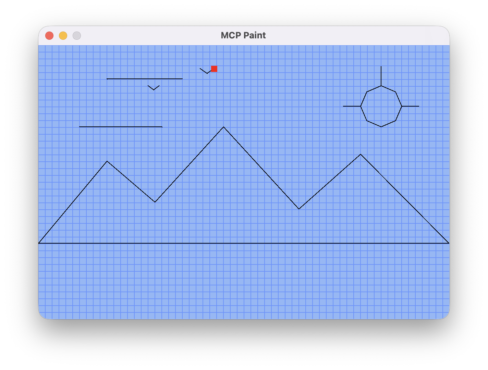

# MCP Paint

A Java Swing drawing app for learning the Model Context Protocol (MCP). Draw with the mouse, then ask **Claude Desktop** to draw on the same canvas. Both inputs write to an observable blackboard.

> [!TIP]
> Claude draw in the MCP Paint App a little cabin with mountains in the back, trees, a beautiful sunset, and some birds.




## 1. Install and build

Install a JDK (Java 17 or newer) and Apache Maven. Run `java -version` and `mvn -version` to check that Maven uses the JDK. Install Claude Desktop if you want to try the MCP tools.

To run a published build, download the runnable JAR from [Releases](https://github.com/csc-5100/app-mcp-paint/releases) and run `java -jar mcp-paint-<version>.jar` using the downloaded filename. To build from source, clone the repository:

```sh
git clone https://github.com/csc-5100/app-mcp-paint.git
cd app-mcp-paint
mvn clean verify
```

If GitHub requests access, sign in with an account that can read this repository. Maven creates the runnable JAR at `target/mcp-paint-1.0.jar`.

## 2. Draw with the mouse

From the repository folder, run:

```sh
java -jar target/mcp-paint-1.0.jar
```

Press and drag the left mouse button to draw. Release to lift the pen. Each stroke stays on the canvas. A blue cursor means the pen is up, and a red cursor means it is down.

## 3. Connect Claude Desktop

Claude Desktop launches its own Paint window and communicates with the Java process over standard input and output (stdio).

1. Find the absolute path to Java and to the JAR. On macOS, run `/usr/libexec/java_home` and append `/bin/java` to the reported JDK directory. From the repo folder, run `echo "$PWD/target/mcp-paint-1.0.jar"` for the JAR path. On Windows, use the full path to `java.exe` and escape backslashes in JSON or use forward slashes.
2. Open `claude_desktop_config.json`. On macOS it lives at `~/Library/Application Support/Claude/claude_desktop_config.json`. On Windows it lives at `%APPDATA%\Claude\claude_desktop_config.json`.
3. For a new config, use the example below. If the file already has an `mcpServers` object, add only the `mcp-paint` entry inside it, preserving the other entries. Replace both paths. JSON uses commas between entries and no trailing comma.

```json
{
  "mcpServers": {
    "mcp-paint": {
      "command": "/absolute/path/to/jdk/bin/java",
      "args": ["-jar", "/absolute/path/to/app-mcp-paint/target/mcp-paint-1.0.jar"]
    }
  }
}
```

4. Save the config, fully quit Claude Desktop, and reopen it. On Mac, use **⌘Q** to quit. Look for the **MCP Paint** window Claude opens.
5. Draw a square with the mouse in that window. Then ask Claude:

   > Use MCP Paint's get_position tool to tell me where the cursor is. Then use move and set_pen to draw a triangle beside my square.

If the triangle appears beside the mouse-drawn square, both inputs are working on the same blackboard. If Paint does not appear, check that the JSON is valid, that both paths exist, and that you fully restarted Claude Desktop. On macOS, Claude's MCP logs are under `~/Library/Logs/Claude`.

## Tools

| Tool | What it does |
|---|---|
| `get_position()` | Returns cursor coordinates, pen state, and canvas bounds. |
| `move(dx, dy)` | Moves by whole pixels. Positive X goes right and positive Y goes up. A lowered pen draws a line. |
| `set_pen(down)` | Lowers the pen to draw or lifts it to move between strokes. |

Try asking Claude for a house with a triangular roof and two windows. The three tools are enough to draw each part. Claude chooses the sequence of moves.

## Follow the code

- `Main` creates the server and the Swing window.
- `MCPServer` starts stdio and registers the tool definitions.
- `ToolsHandler` translates MCP calls into blackboard operations.
- `DrawingMouseListener` translates mouse events into blackboard operations.
- `Blackboard` extends `PropertyChangeSupport` and stores the shared cursor, pen state, and strokes.
- `DrawingPanel` observes the blackboard and repaints the canvas.

The MCP connection uses stdio. The demo needs no HTTP listener, or AWS service.

